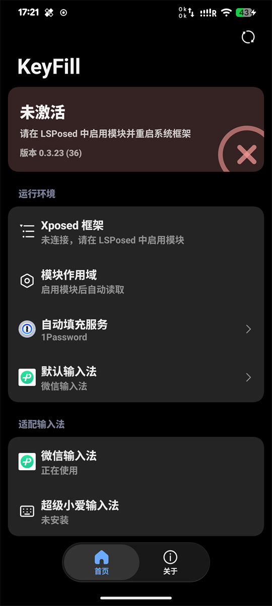

<div align="center">
  
  <h1>KeyFill</h1>
  <p><strong>为微信输入法与超级小爱输入法接入 Android 原生内联自动填充建议</strong></p>
  <p>
    <a href="https://github.com/zrmugua/keyfill/actions/workflows/build.yml"></a>
    
    
    <a href="LICENSE"></a>
  </p>
</div>

---

## 简介

默认情况下，Android 的键盘内联自动填充（Inline Autofill Suggestions）在许多国产输入法中未被启用或未接入渲染通道，导致 **1Password**、**Bitwarden**、**Google 密码管理工具** 等密码管理器只能退化为悬浮弹窗，甚至无法在键盘顶部直接点选填充。

**KeyFill** 是一个基于现代 **libxposed API 102** 的 LSPosed 模块，在不破坏输入法原有视觉体验的前提下，让 **微信输入法** 与 **超级小爱输入法** 原生支持键盘顶部内联自动填充卡片。

## 功能特性

- **原生内联建议接入**：在系统框架与目标输入法进程建立完整的 `InlineSuggestionsRequest` / `InlineSuggestionsResponse` 通道，支持 1Password、Bitwarden 等标准 Android 自动填充服务。
- **输入法原生视觉融合**：
  - **微信输入法（`com.tencent.wetype`）**：保留左侧原生图标，复用原生候选栏外框，单条居中撑满、多条横向滑动并通过 `SurfaceControl` 精准裁切，打字与展开面板时自动避让。
  - **超级小爱输入法（`com.xiaomi.type`）**：对齐工具栏高度与右侧入口，兼容 HyperOS 实时模糊背板挖空融合，输入候选词时自动隐藏不抢占空间。
- **深浅色实时同步**：跟随系统深色 / 浅色模式动态切换内联建议卡片样式并刷新远程渲染缓存，无需重启输入法。
- **HyperOS 风格管理界面**：基于 **Miuix** 与液态玻璃底栏构建，接入 `libxposed:service` 实时检测模块激活状态、已注入进程状态，支持一键弹窗申请缺失的 LSPosed 作用域，以及快捷跳转系统自动填充与输入法设置。

## 界面预览

| 首页（深色） | 关于页（深色） | 首页（浅色） | 关于页（浅色） |
| :---: | :---: | :---: | :---: |
|  |  |  |  |

## 环境要求与支持列表

- **系统版本**：Android 16+（API 36+）
- **Xposed 框架**：支持 **libxposed API 102** 的现代框架（如新版 LSPosed）
- **适配输入法**：
  - 微信输入法（`com.tencent.wetype`）
  - 超级小爱输入法（`com.xiaomi.type`）
- **适配密码管理器**：1Password、Bitwarden、KeePassDX、Proton Pass 等所有遵循 Android Autofill Inline API 的自动填充服务

## 安装与配置步骤

1. 下载并安装 **KeyFill** APK。
2. 打开 **LSPosed 管理器**，启用 **KeyFill** 模块，勾选以下作用域：
   - **系统框架**（`android`）—— **必选**（用于宣告输入法内联能力并同步深浅色远程渲染样式）
   - **微信输入法**（`com.tencent.wetype`）和 / 或 **超级小爱输入法**（`com.xiaomi.type`）
   > 也可以只先在 LSPosed 中开启模块开关，随后打开 KeyFill 应用点击「模块作用域」一键弹窗申请所需作用域。
3. **重启系统**（或软重启系统框架）并确保目标输入法进程已重新加载。
4. 在系统设置中确认已将自动填充服务设为你的密码管理器（如 1Password / Bitwarden），并将默认输入法切换为微信输入法或超级小爱输入法；打开 **KeyFill** 首页看到 **「工作中」** 即表示全部就绪。

## 本地构建

请确保本地已安装 **JDK 21** 与 **Android SDK**，随后在项目根目录执行：

```bash
# Linux / macOS
./gradlew assembleDebug lintDebug

# Windows PowerShell
.\gradlew.bat assembleDebug lintDebug
```

构建产物位于 `app/build/outputs/apk/debug/app-debug.apk`。

## 工作原理简述

1. **`system_server` 能力开启与主题重绘**：
   - `AutofillModule` 拦截 `InputMethodInfo` 构造过程，为目标输入法开启 `mInlineSuggestionsEnabled`。
   - `InlineThemeRenderer` 在 `RemoteInlineSuggestionRenderService` 侧按当前系统深浅色切换 `InlinePresentationSpec` 样式束，并在主题变化时使旧 `RemoteInlineSuggestionUi` 缓存失效以触发实时重绘。
2. **输入法端会话桥接与视图承载**：
   - 在目标输入法的 `InputMethodService` 创建时注入 `mInlineSuggestionSessionController` 的请求与响应回调。
   - `KeyboardInlineUi` 与 `XiaoAiToolbar` 将返回的 `InlineSuggestion` 远程 Surface 挂载至候选栏区域，并通过 `SurfaceControl` 事务与 `ViewOutlineProvider` 处理滑动裁切、输入避让及模糊背景透出。

## 开源致谢

- [libxposed / LSPosed](https://github.com/libxposed)：现代 Xposed 模块 API 与服务通信框架
- [Miuix](https://github.com/miuix-kotlin-multiplatform/miuix)：HyperOS 风格 Compose Multiplatform UI 与液态玻璃组件库

## 开源许可

本项目基于 [Apache License 2.0](LICENSE) 开源。
