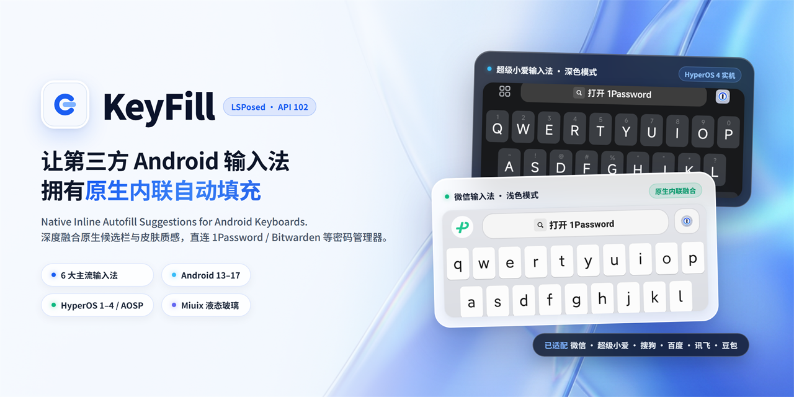
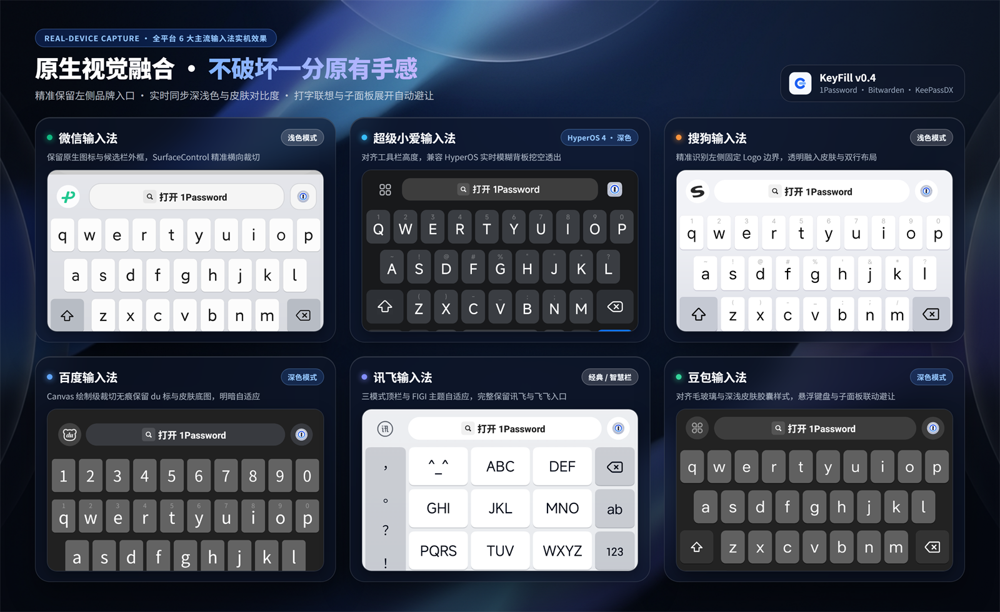
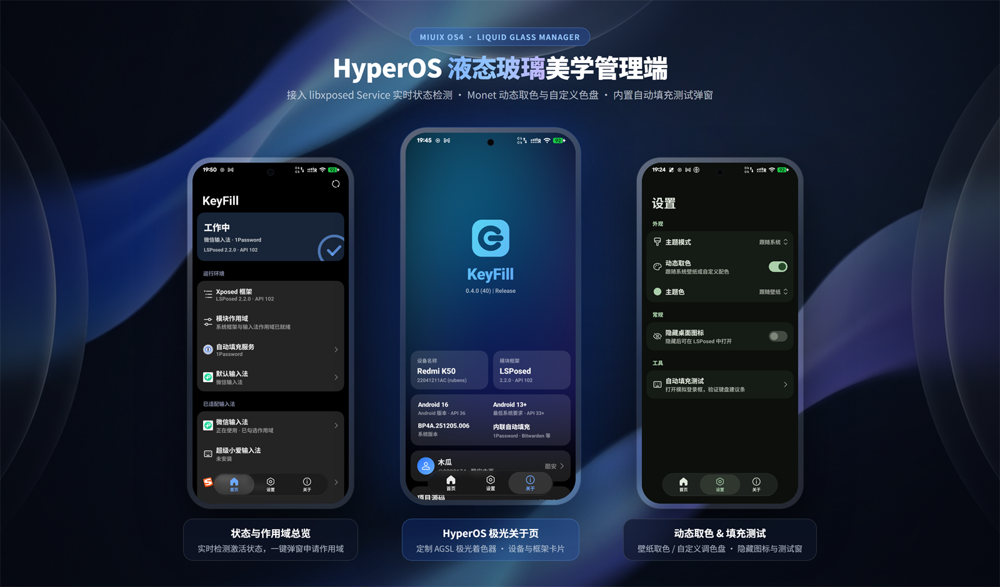
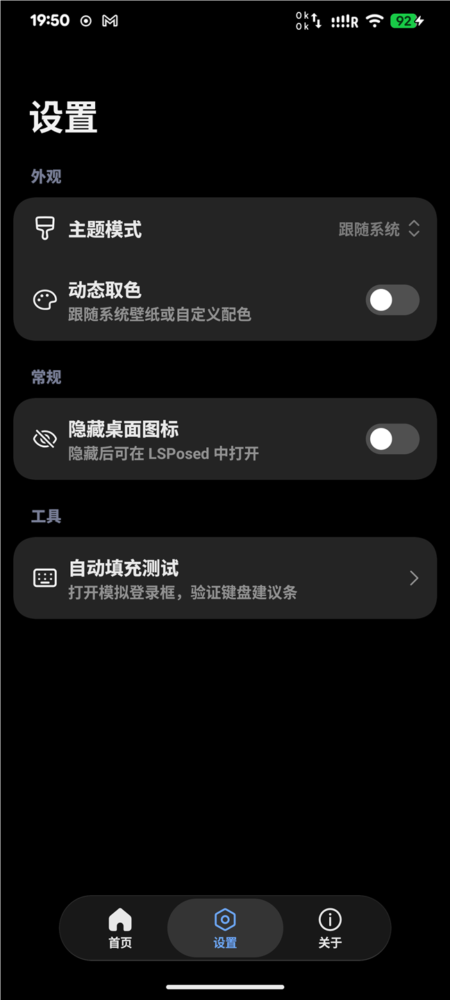
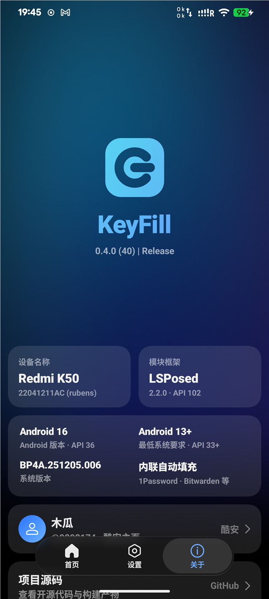
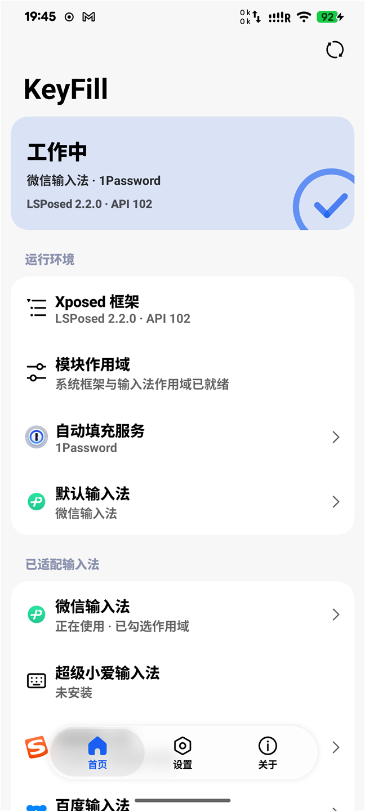
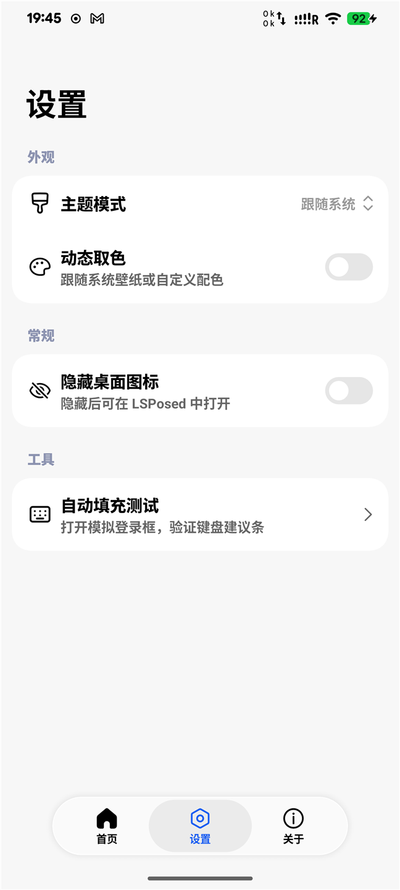
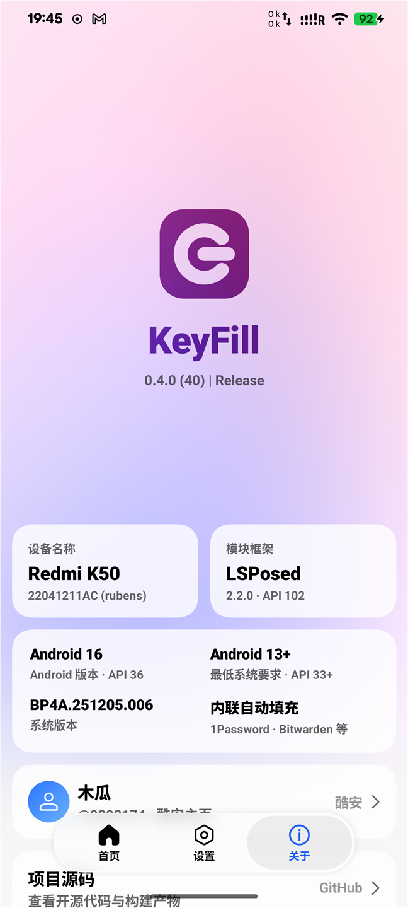

<div align="center">
  
  <br />
  <br />
  <p>
    <a href="https://github.com/zrmugua/keyfill/actions/workflows/build.yml"></a>
    
    
    
    <a href="https://www.coolapk.com/u/9898174"></a>
    <a href="LICENSE"></a>
  </p>
</div>

---

## 简介

默认情况下，Android 的键盘内联自动填充（Inline Autofill Suggestions）在许多第三方输入法中未被启用或未接入渲染通道，导致 **1Password**、**Bitwarden**、**KeePassDX**、**Google 密码管理工具** 等密码管理器只能退化为悬浮弹窗，无法在键盘顶部候选栏内直接点选填充。

**KeyFill** 是一个基于现代 **libxposed API 102** 的 LSPosed 模块，采用可扩展的 `KeyboardTarget` 与 `ImeToolbar` 适配架构，在不破坏输入法原有视觉体验与手感的前提下，为第三方输入法补齐原生键盘内联自动填充能力（目前已深度适配**微信输入法**、**超级小爱输入法**、**搜狗输入法**、**百度输入法**、**讯飞输入法**与**豆包输入法**）。

## 实机效果一览

<div align="center">
  
</div>

## 功能特性

- **原生内联建议接入**：在系统框架与目标输入法进程建立完整的 `InlineSuggestionsRequest` / `InlineSuggestionsResponse` 通道，支持 1Password、Bitwarden 等所有遵循 Android Autofill Inline API 的自动填充服务，并对 `1:1` 置顶图标与多条横向滑动建议做自适应排版。
- **6 大输入法原生视觉融合**：
  - **微信输入法（`com.tencent.wetype`）**：保留左侧原生图标，复用原生候选栏外框，单条居中撑满、多条横向滑动并通过 `SurfaceControl` 精准裁切，打字与展开面板时自动避让。
  - **超级小爱输入法（`com.xiaomi.type`）**：对齐工具栏高度与右侧入口，兼容 HyperOS 实时模糊背板挖空融合，输入候选词时自动隐藏不抢占空间。
  - **搜狗输入法（`com.sohu.inputmethod.sogou`）**：精准识别左侧固定 Logo 边界并裁切闲置工具图标，透明融入各类自定义皮肤与双行拼音布局，展开工具箱或候选词时即时避让。
  - **百度输入法（`com.baidu.input`）**：通过 `Canvas` 绘制级裁切无痕保留左侧原生 `du` 图标与完整皮肤底图，支持默认、夜间及自定义动态皮肤对比度自适应。
  - **讯飞输入法（`com.iflytek.inputmethod`）**：全面适配 `CandidateNext`、`SmartLine` 与经典 `InputGridRootView` 三模式顶栏及 `FIGI` 主题服务，保留原生讯飞 / 飞飞助手入口并自适应皮肤明暗，输入、联想词、手写及展开面板（`ImeFragmentShow`）时自动避让。
  - **豆包输入法（`com.bytedance.android.doubaoime`）**：保留左侧原生豆包工具箱入口，胶囊样式对齐原生浅色、深色与透明毛玻璃皮肤，切换子面板或悬浮键盘时联动隐藏 `SurfaceControl`。
- **深浅色与自定义皮肤同步**：同时兼容系统深色 / 浅色模式动态重绘与输入法独立皮肤明暗检测，确保内联建议胶囊与文字始终清晰可读。
- **Miuix OS4 液态玻璃管理端**：
  - 接入 `libxposed:service` 实时检测模块激活状态、框架版本、已注入进程及作用域就绪状态，支持一键弹窗申请缺失作用域与快捷跳转系统自动填充 / 输入法设置。
  - 支持**主题模式**（跟随系统 / 浅色 / 深色）、**动态取色**（跟随系统壁纸 Monet 配色、15 套精选预设色与自定义调色盘）以及**隐藏桌面图标**。
  - 内置**自动填充测试**液态玻璃弹窗，无需切换外部应用即可直接模拟账号 / 密码输入框验证键盘内联建议条。
  - 采用定制 AGSL 极光着色器打造 HyperOS 风格「关于」页与设备硬件卡片。

## 管理端预览

<div align="center">
  
</div>

<details>
<summary>展开查看全部单页实机截图（深色 / 浅色）</summary>

<br />

| 首页（深色） | 设置（深色） | 关于（深色） |
| :---: | :---: | :---: |
|  |  |  |

| 首页（浅色） | 设置（浅色） | 关于（浅色） |
| :---: | :---: | :---: |
|  |  |  |

</details>

## 环境要求与支持列表

- **系统版本**：Android 13 – 17（API 33+，兼容 HyperOS 1 / 2 / 3 / 4 及原生 AOSP）
- **Xposed 框架**：支持 **libxposed API 102** 的现代框架（如新版 LSPosed）
- **适配密码管理器**：1Password、Bitwarden、KeePassDX、Proton Pass、Google 密码管理工具等所有遵循 Android Autofill Inline API 的自动填充服务
- **已适配输入法**：

| 输入法 | 包名 | 适配特性 |
| :--- | :--- | :--- |
| 微信输入法 | `com.tencent.wetype` | 原生候选栏复用 · `SurfaceControl` 精准裁切 |
| 超级小爱输入法 | `com.xiaomi.type` | HyperOS 实时模糊背板融合 · 工具栏对齐 |
| 搜狗输入法 | `com.sohu.inputmethod.sogou` | 左侧 Logo 边界识别 · 自定义皮肤与双行布局融合 |
| 百度输入法 | `com.baidu.input` | `Canvas` 级皮肤裁切保留 `du` 标 · 动态明暗对比 |
| 讯飞输入法 | `com.iflytek.inputmethod` | 经典 / 智慧栏三模式顶栏 · `FIGI` 主题与面板避让 |
| 豆包输入法 | `com.bytedance.android.doubaoime` | 毛玻璃与深浅皮肤胶囊对齐 · 悬浮键盘联动 |

## 安装与配置步骤

1. 下载并安装 **KeyFill** APK。
2. 打开 **LSPosed 管理器**，启用 **KeyFill** 模块，勾选以下作用域：
   - **系统框架**（`android`）—— **必选**（用于宣告输入法内联能力并同步深浅色远程渲染样式）
   - 你正在使用的已适配输入法（微信、超级小爱、搜狗、百度、讯飞或豆包输入法）
   > 也可以先仅在 LSPosed 中开启模块开关，随后打开 KeyFill 首页点击「模块作用域」一键弹窗申请所需作用域。
3. **重启系统**（或软重启系统框架）并确保目标输入法进程已重新加载。
4. 在系统设置中确认已将自动填充服务设为你的密码管理器（如 1Password / Bitwarden），并将默认输入法切换为已适配的输入法；打开 **KeyFill** 首页看到 **「工作中」** 即表示全部就绪，随后可在「设置 → 自动填充测试」中直接验证效果。

> [!TIP]
> 在 HyperOS 等深度定制系统上，若密码管理器偶发无法弹出自动填充建议，建议在系统省电策略中将密码管理器设为 **「无限制」** 并开启自启动，避免系统后台冻结自动填充服务进程。

## 本地构建

请确保本地已安装 **JDK 17+**（或 Android Studio 内置 JBR）与 **Android SDK**，随后在项目根目录执行：

```bash
# Linux / macOS
./gradlew assembleDebug lintDebug
./gradlew assembleRelease

# Windows PowerShell
.\gradlew.bat assembleDebug lintDebug
.\gradlew.bat assembleRelease
```

- Debug 产物位于 `app/build/outputs/apk/debug/app-debug.apk`
- Release（R8 混淆优化）产物位于 `app/build/outputs/apk/release/app-release.apk`

## 工作原理简述

1. **`system_server` 能力开启与主题重绘**：
   - `AutofillModule` 拦截 `InputMethodInfo` 构造过程，为 `KeyboardTarget` 中登记的目标输入法开启 `mInlineSuggestionsEnabled`。
   - `InlineThemeRenderer` 在 `RemoteInlineSuggestionRenderService` 侧按当前系统与皮肤明暗切换 `InlinePresentationSpec` 样式束，并在主题变化时使旧 `RemoteInlineSuggestionUi` 缓存失效以触发实时重绘。
2. **输入法端会话桥接与视图承载**：
   - 在目标输入法的 `InputMethodService` 创建时注入 `mInlineSuggestionSessionController` 的请求与响应回调。
   - `KeyboardInlineUi` 与各输入法专属 `ImeToolbar` 适配器（`XiaoAiToolbar`、`SogouToolbar`、`BaiduToolbar`、`IflytekToolbar`、`DoubaoToolbar`）将返回的 `InlineSuggestion` 远程 Surface 无痕挂载至顶栏区域，并通过 `SurfaceControl` 事务、`Canvas` 裁切与 `ViewOutlineProvider` 处理滑动裁切、输入避让及模糊背景透出。
3. **管理端实时状态与可视化配置**：
   - `XposedServiceState` 基于 `libxposed:service` 监听框架连接、作用域与进程注入状态；`ManagerUi` 与 `AboutBgEffect` 基于 **Miuix OS4** 液态玻璃组件与 AGSL 极光着色器构建完整交互体验。

## 开源致谢

- [libxposed / LSPosed](https://github.com/libxposed)：现代 Xposed 模块 API 与服务通信框架
- [Miuix](https://github.com/miuix-kotlin-multiplatform/miuix)：HyperOS 风格 Compose Multiplatform UI 与液态玻璃组件库

## 开源许可

本项目基于 [Apache License 2.0](LICENSE) 开源。
